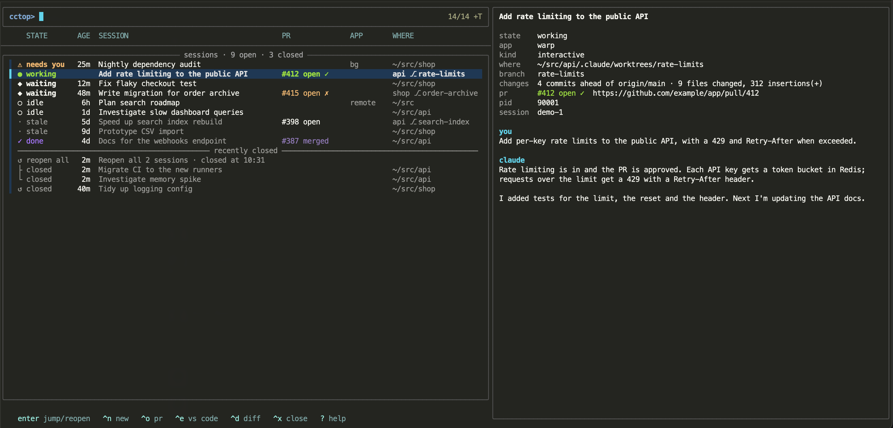

# cctop

A live dashboard of your running [Claude Code](https://claude.com/claude-code) sessions, built for a pinned
[Warp](https://www.warp.dev) tab. Think `ctop`, but for Claude sessions.



## What it does

- **Every session at a glance:** what each one is working on (its title), whether Claude is working or waiting
  on you, how long it has been idle, its worktree, and its PR with review state. Stale sessions (idle for
  2+ days) and done ones (PR merged) fade out so you can see what to close.
- **Preview:** your last prompt and Claude's last reply, the branch, and how far it is from the default branch,
  including uncommitted changes.
- **Jump to a session's tab** with `enter`, using Warp's per-session focus link. No tab cycling.
- **Close** a session and its tab with `^x`. Claude exits cleanly and the conversation stays resumable.
- **Recently closed:** sessions that ended in the last 24 hours, however they ended, each reopenable in a new
  tab. Sessions that closed together (a Warp restart, say) are grouped so you can reopen them all at once, in
  their original tab order.
- **New session** in a new tab with `^n`, diff with `^d`, open in VS Code with `^e`, open the PR with `^o`.
  `^t` switches between all sessions and only those in Warp tabs. `?` shows every key.

## Requirements

- macOS
- [Warp](https://www.warp.dev) (the Stable channel). The list works in other terminals, but jumping to tabs,
  closing tabs and reopening don't.
- Python 3 (tested on 3.15)
- [fzf](https://github.com/junegunn/fzf) 0.71 or newer
- The Claude Code CLI (`claude`)
- Optional: [`gh`](https://cli.github.com) for PR states, VS Code's `code` command, `diff-so-fancy` for nicer
  diffs

## Install

`cctop` is a single file. Put it anywhere on your `PATH`:

```sh
git clone https://github.com/chriskoelle/cctop.git ~/src/cctop
mkdir -p ~/.local/bin
ln -s ~/src/cctop/cctop ~/.local/bin/cctop
```

If `~/.local/bin` isn't on your `PATH` yet, add `export PATH="$HOME/.local/bin:$PATH"` to your `~/.zshrc`.

Then run `cctop` in a Warp tab and pin it.

To see what it looks like without any sessions running, `CCTOP_DEMO=1 cctop` shows made-up sessions. It
doesn't read your sessions or touch Claude Code or Warp files, and key actions are turned off.

## How it works, and what can break

`cctop` lists sessions with `claude agents --json`, then reads more detail from Claude Code's local files:
`~/.claude/sessions/<pid>.json` for live status, and the end of each transcript in `~/.claude/projects/` for
titles, PR links and last messages. Jumping uses the `WARP_FOCUS_URL` environment variable Warp sets in every
tab, and reopening writes temporary tab configs to `~/.warp/tab_configs/`. Tab order for reopen-all comes from
Warp's local state database.

**Only `claude agents --json` is a documented interface.** The session files, transcript format,
`WARP_FOCUS_URL` and Warp's database are internal details, so a Claude Code or Warp update can break parts of
`cctop`. Issues are welcome.

`cctop` keeps its own state in `~/.cache/cctop/`: cached transcript details, PR states, and which sessions it
has seen end, for the recently closed list. Recently closed only knows about sessions that ended while `cctop`
was running or since it last ran.

## License

MIT
